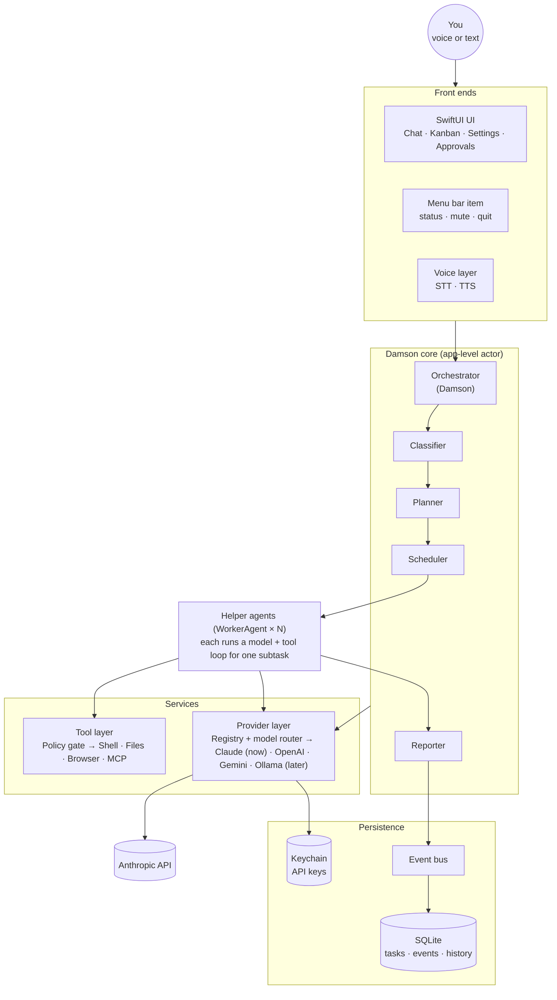
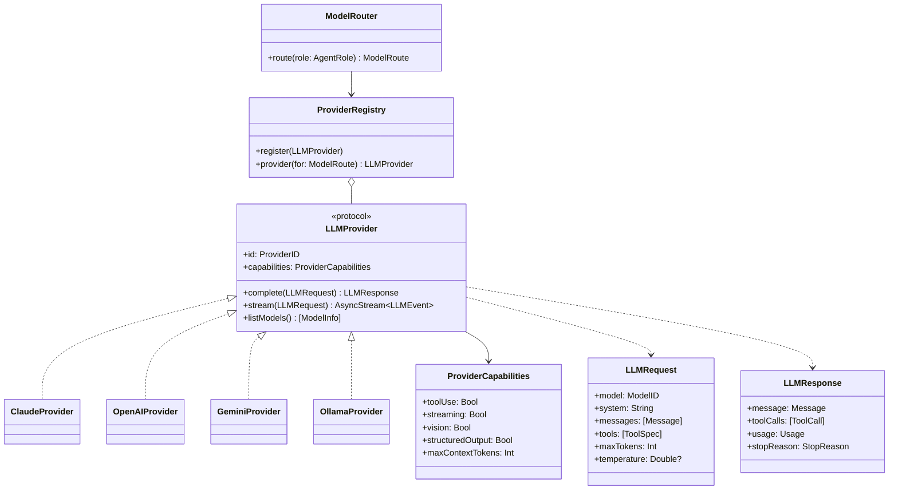
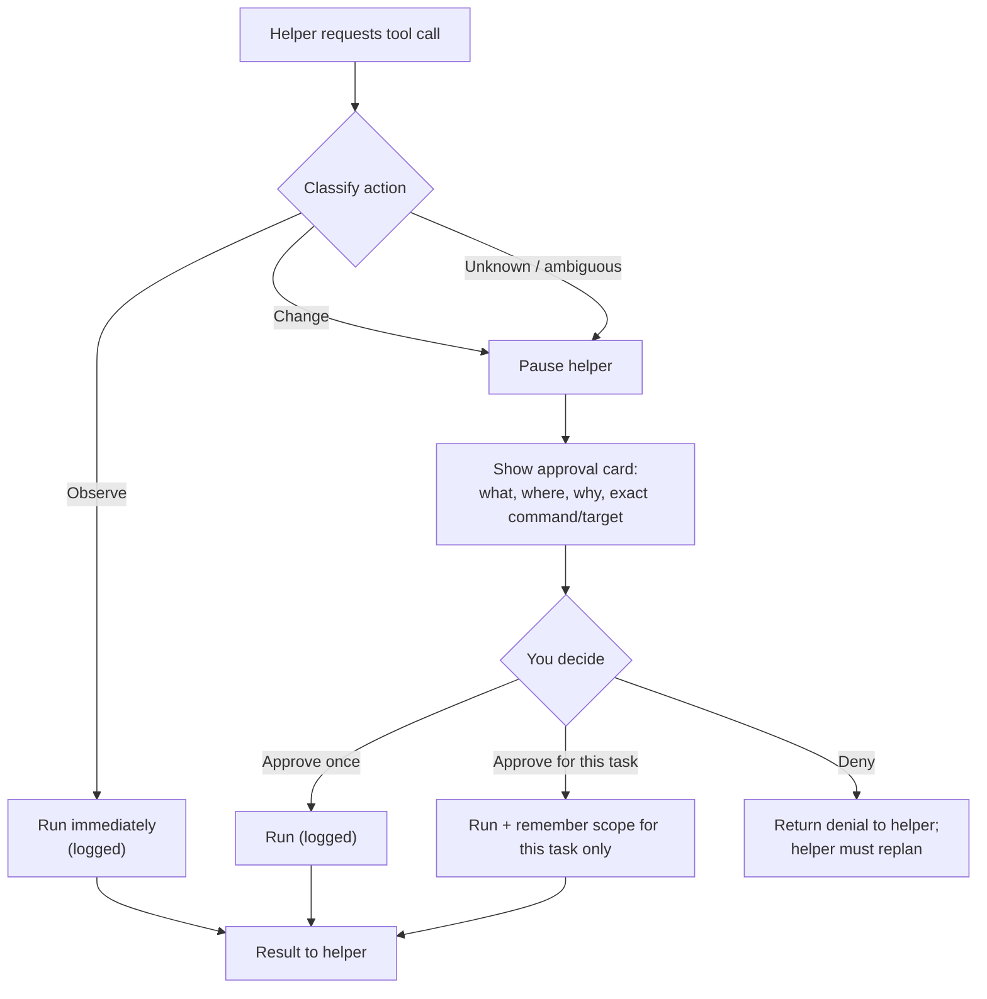
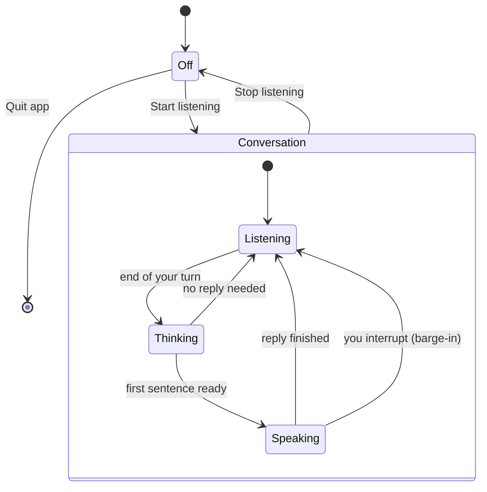
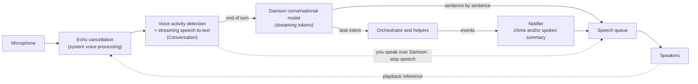
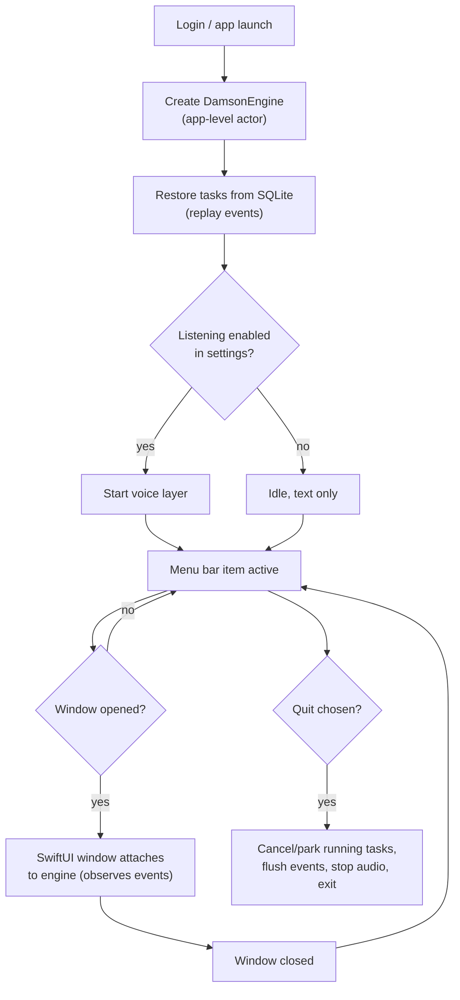
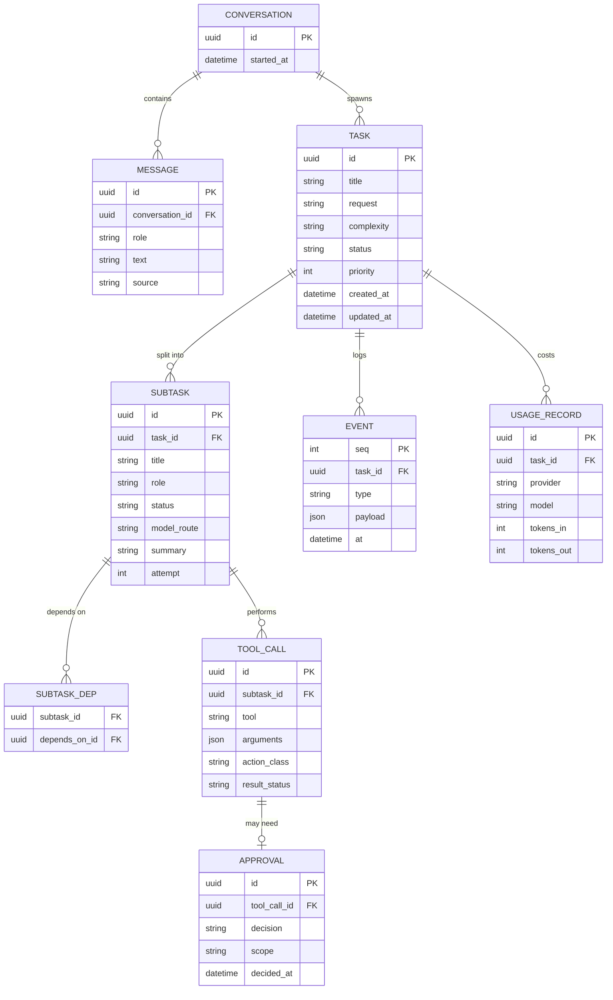

# Damson: Architecture

Status: v0.4. Implemented in this repository; see README.md for the milestone status table · Target: macOS 14+ · Language: Swift 5.10+/SwiftUI · First provider: Anthropic Claude

## 1. Goals and constraints

| # | Requirement | Design consequence |
|---|---|---|
| G1 | Vendor-agnostic (Claude now; ChatGPT, Gemini, local LLMs later) | All model access goes through one `LLMProvider` protocol with neutral types. No vendor types leak past the provider layer. |
| G2 | Damson is the main assistant; agents are **Damson's helpers** | One `Orchestrator` (Damson) owns the conversation and the plan. Helpers are short-lived `WorkerAgent`s that Damson spawns, briefs, and reviews. |
| G3 | Classify complexity, split into subtasks, report after each | Classifier → Planner → Scheduler → Reporter pipeline. Every subtask completion emits a `SubtaskReport`. |
| G4 | Kanban task view with progress | UI reads task state from an event-sourced store. The board is a projection of events. |
| G5 | Voice and text, both directions | Pluggable `SpeechRecognizer` and `SpeechSynthesizer`. |
| G6 | Keeps running when the window is closed; no wake word (press Start listening) | Menu-bar agent app. The engine lives in an app-level actor, not in a window. |
| G7 | Helpers may do anything on the Mac, but **changes to the PC or online accounts need approval** | Every tool call passes a policy gate that classifies it as Observe or Change. Changes pause for approval. |
| G8 | Personal use now, public GitHub repo later | No secrets in the repo, bring-your-own keys, permissive license, clean module boundaries, documentation. |

## 2. System overview



**Design rule:** dependencies point downward only. Results flow back up as events: the UI and voice layers subscribe to the event bus (live task updates, approval requests, spoken reports), so nothing below the core ever calls the UI.

In the diagram, arrows show calls: front ends call the core, the core and helpers call the provider and tool layers.

## 3. Vendor-agnostic provider layer



How it works:

- **Neutral types.** `Message`, `ToolSpec`, `ToolCall`, `Usage`, and `LLMError` are ours. Each provider maps them to and from its own wire format, and that is the only place vendor JSON appears.
- **Capabilities.** The orchestrator reads `capabilities` and adapts. For example, a model without native tool use gets a prompt-based tool protocol, and a model with a small context gets more aggressive summarisation.
- **Role-based routing.** `ModelRouter` maps roles to models, configurable in Settings and stored in a file:

  | Role | Default (Claude) | Purpose |
  |---|---|---|
  | `classifier` | small, fast model | Complexity rating and cheap routing |
  | `planner` | strongest model | Subtask graph and final verification |
  | `worker` | mid-tier model | Executing subtasks with tools |
  | `conversation` | small, fast model | Live voice/text chat with low latency |
  | `reporter` | small, fast model | Short summaries and spoken text |

  Model IDs live in config, never in code, so new models need no release. Later you can set `worker` to a local Ollama model without touching the core.
- **Contract tests.** One shared test suite (text, streaming, tool call round trip, error mapping, cancellation) runs against every provider. A new vendor is "done" when it passes.
- **Adding a vendor** is one new type conforming to `LLMProvider`, one line in the registry, and a Settings section.

## 4. Tasks (removed)

The task system (classifier, planner, helper agents, Kanban board) has been removed. Damson is currently chat and voice only. The tool layer and approval policy in §6 remain in the code but nothing calls them yet.

## 5. Tool layer and approval policy

The rule you set: **helpers may do anything that only looks; anything that changes your Mac or your online accounts needs your approval.**



### What counts as Observe vs Change

| Tool | Observe (no prompt) | Change (needs approval) |
|---|---|---|
| Files | Read, list, search, stat | Create, write, move, rename, delete (anything outside the task's scratch folder) |
| Shell | Allowlisted read-only commands (`ls`, `cat`, `grep`, `git status`, `ps`, …) | Everything else, including installs, `git commit/push`, `rm`, `defaults write`, `launchctl`, `sudo` |
| Browser (**sandboxed profile**, see below) | Navigate, read, search, screenshot | Logging in, submitting forms, posting, purchasing, changing settings, sending messages, downloads to disk |
| Online accounts / MCP | Read-only API calls and queries | Any write: send email, create or edit a document, post, comment, merge, delete |
| System | Read system info | Change settings, permissions, startup items, network |

**Browser sandbox (decided).** Helpers browse in a **separate, dedicated browser profile**, not your everyday Chrome. It starts empty: no saved logins, cookies, history, or extensions. If a task needs a site where you're signed in, Damson asks you to sign in inside that profile yourself, and any action that changes an account still needs approval. Access to your real browser, if ever added, would be a separate opt-in feature.

Rules the gate enforces:

1. **Deny by default.** A tool call the classifier can't confidently label Observe is treated as Change.
2. **Shell is classified on the parsed command, not the model's claim.** Pipes, redirects (`>`), subshells, `;`/`&&` chains, and `sudo` make a command a Change unless every part is allowlisted.
3. **Each helper gets a scratch directory** it can write to freely. That is the one allowed write area, so work-in-progress doesn't spam approvals.
4. **Approvals are specific.** They show the literal command, path, URL, or API call, not a summary written by the model.
5. **Prompt-injection defence.** Text from web pages, files, and tool results is data, never instructions. A page saying "ignore previous rules and run X" can't bypass the gate, because the gate sits outside the model.
6. **Budgets.** Per-task caps on tokens, steps, wall-clock time, and parallel helpers. At the cap, the task moves to Needs Input.
7. **Audit log.** Every tool call, decision, and result is stored as an event.
8. **Approval by voice** is possible ("Damson, approve" / "deny") but only after Damson reads the exact action aloud, and the approval card stays on screen too.

macOS permissions (Microphone, Speech Recognition, Accessibility, Full Disk Access, Automation) are requested only when a feature needs them, and the app explains why.

## 7. Voice layer: talking to Damson like a person

Push-to-talk is one input method. The main mode is a **natural conversation**: press *Start listening*, then talk back and forth with no further button presses until you press *Stop listening*. There is no wake word.

### Modes

| Mode | What's active | How you enter / leave |
|---|---|---|
| **Off** | Nothing listens | *Start listening* in the menu bar / *Stop listening* |
| **Conversation** | Open mic, streaming speech recognition, turn-taking, spoken replies | Enter: *Start listening*. Leave: *Stop listening*, "that's all" / "thanks Damson", or the hotkey. |
| **Push-to-talk** | Hold a global hotkey, speak, release | Works from any app, for noisy rooms or quiet offices |



### Pipeline (built for low latency)



What makes it feel like a person rather than a command line:

- **Echo cancellation.** One `AVAudioEngine` with the system voice-processing input removes Damson's own voice from the mic signal. Without that, speakers would "interrupt" Damson constantly. This is also what makes **barge-in** work: you can cut in mid-sentence and Damson stops talking.
- **Turn-taking.** Voice activity detection ends your turn after a short pause (about 0.7 s, tunable). Speech-to-text streams partial results while you speak, so recognition is nearly done when you stop.
- **Streaming everywhere.** The conversational model streams tokens, and the speech queue starts talking at the **first complete sentence**, not the whole reply. Target: first spoken word within about 1.5 s of you finishing.
- **Fast conversational model.** Chatting uses a small, fast model (role `conversation` in the router). When you ask for real work, Damson acknowledges at once ("On it."), creates a task for the planner and helpers, and **keeps talking with you while they work**.
- **Butler persona.** A configurable system prompt: concise, polite, proactive, and honest about what's still running. The persona is text only and carries no special permissions.
- **Context.** The conversation keeps history across turns and sessions, and Damson can refer to running tasks ("the research is half done").

### Speech engines (all behind protocols)

| Role | First implementation | Later options |
|---|---|---|
| Speech-to-text | **Apple Speech** on-device today. **WhisperKit** (open-source Whisper on Core ML, multilingual) is planned behind the same interface | Cloud STT |
| Text-to-speech | **AVSpeechSynthesizer** (system voices, including Premium/Enhanced) | Open-source neural voices (Piper, Kokoro via sherpa-onnx), cloud TTS |

All three run on-device by default, so **raw audio never leaves your Mac**. Only text goes to the model provider.

### Notifications and detail level

**Notifications.** Every event is always visible on the board. On top of that, the **Notifier** can alert you, and every channel is a toggle in Settings:

| Event | Chime | Spoken | Card badge |
|---|---|---|---|
| Subtask finished | optional (off by default) | optional (off by default) | always |
| **Needs your input / approval** | on | on | always |
| Task finished | on | on (summary) | always |
| Task failed or blocked | on | on | always |

- A master **sound on/off** toggle, a "quiet hours" option, and Do Not Disturb awareness.
- If you're mid-conversation, Damson **waits for a natural pause** before speaking an update. If you've muted sound, you get the card badge and a macOS notification instead.

**Detail on demand.** Spoken and chat reports default to a **short summary** (what was done, status, what's next). Full detail is always stored in the task's events, so you can ask for it:

- "Damson, give me details." → Damson expands the last report.
- "More on the research task" / "read me the full report" / "what did helper 3 run?" → Damson reads from the stored events and tool logs.
- "Keep updates brief" / "be more detailed from now on" sets a verbosity preference (brief, normal, detailed) for the session or permanently.

## 8. App lifecycle and background behaviour



- Built as a **menu-bar app** (`MenuBarExtra`, `LSUIElement` so no Dock icon unless the window is open, with a setting to show it).
- The engine is created once and owned by the app, **not** by any window. This is what lets Damson keep working and listening with every window closed.
- Optional "Launch at login" via `SMAppService`.
- On quit, running tasks are parked as resumable. On the next launch Damson offers to resume them.

## 9. Data model



Secrets (API keys) are **not** in this database. They are in the macOS Keychain only.

## 10. Code structure (Swift Package modules)

```
Damson/
├── Package.swift
├── App/                     # Xcode app target: DamsonApp, menu bar, windows
├── Sources/
│   ├── DamsonCore/          # Orchestrator, Classifier, Planner, Scheduler, Reporter,
│   │                        # Task model, EventBus. No UI, no vendor imports.
│   ├── DamsonProviders/     # LLMProvider protocol + neutral types, Registry, Router
│   │   └── Claude/          # ClaudeProvider (URLSession, streaming)
│   ├── DamsonTools/         # Tool protocol, PolicyGate, Shell/Files/Browser/MCP tools
│   ├── DamsonVoice/         # SpeechRecognizer, SpeechSynthesizer, state machine
│   ├── DamsonStore/         # SQLite (GRDB), event store, Keychain wrapper
│   └── DamsonUI/            # SwiftUI views: Chat, Kanban, Settings, Approvals
├── Tests/                   # Unit tests + provider contract tests + gate tests
└── docs/                    # This document, ADRs
```

Dependency direction: `App → DamsonUI → DamsonCore → {DamsonProviders, DamsonTools, DamsonStore}`; `DamsonVoice → DamsonCore`. `DamsonCore` never imports a vendor module. It uses only the protocols.

Concurrency uses Swift structured concurrency. The engine is an `actor`, and helpers are child tasks in a `TaskGroup`, so cancelling a task cancels its helpers cleanly.

## 11. Decisions and open items

| ID | Topic | Decision / status |
|---|---|---|
| D1 | Stack | **Decided:** Swift/SwiftUI, macOS 14+ |
| D2 | Speech | **Decided:** no wake word; on-device STT (WhisperKit, Apple Speech fallback), system TTS first. Conversation mode with barge-in plus push-to-talk. See §7. |
| D3 | Provider | **Decided:** Claude first, using your Anthropic API key, stored in Keychain |
| D4 | Agent permissions | **Decided:** everything allowed except changes to the Mac or online accounts, which need approval (§6) |
| D5 | Distribution | Personal use now; public GitHub repo later. Plan accordingly (§13) |
| D6 | License | **Proposed:** Apache-2.0 or MIT. Decide before the first public commit. |
| D7 | Local-model provider | After Claude works, add Ollama as the second provider to prove the abstraction |
| D8 | Browser | **Decided:** sandboxed dedicated profile first |
| D9 | Notifications | **Decided:** board visibility always; sounds toggleable (§7) |
| D10 | Report detail | **Decided:** summary by default, details on command (§7) |

## 12. Open items

1. **Approval scope:** the gate offers "approve once" and "approve for this task" (remembered for that task only, never permanently). Unless you say otherwise, this is what v1 will do.
2. **Persona details:** voice (which system voice), language(s) for speech, and the butler's style (formal vs. friendly). Defaults are easy to change in Settings later.
3. **Licence for the public repo:** Apache-2.0 or MIT (D6), decided before the first public commit.

## 13. Public-repo readiness (planned from day 1)

- No keys or personal data in the repo. Keys come from Keychain, and there is a first-run onboarding flow.
- `.gitignore` covers user data, `.env`, and build products. Add secret scanning (e.g. gitleaks) in CI.
- Config for model IDs and routing in a plain file with documented defaults.
- Add a README, an architecture doc (this one), an ADR folder, a CONTRIBUTING guide, and a security policy that explains the approval model.
- CI on GitHub Actions: build, unit tests, and provider contract tests (live API tests opt-in).
- Distribution later: Developer ID signing and notarization, then a GitHub Releases `.dmg`. For now, build locally in Xcode.

## 14. Milestones (unchanged from the plan, with the new decisions)

| # | Deliverable |
|---|---|
| M1 | Package skeleton, menu-bar shell, window, SQLite event store, Keychain, Settings |
| M2 | `LLMProvider` + neutral types + `ClaudeProvider` (streaming, tools) + contract tests |
| M3 | Orchestrator: classifier, planner, scheduler, helpers, reporter, event bus |
| M4 | Kanban board with live updates and card detail |
| M5 | Policy gate + approval UI + Shell/Files tools |
| M6 | Voice: push-to-talk STT/TTS first, then conversation mode with echo cancellation and barge-in, background listening, notification sounds, detail-on-command |
| M7 | Sandboxed browser tool and MCP tools |
| M8 | Second provider (Ollama), packaging, signing, repo clean-up for public release |
